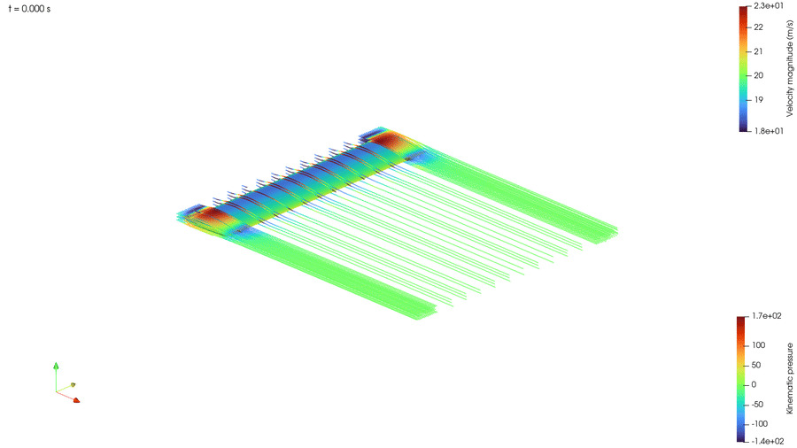
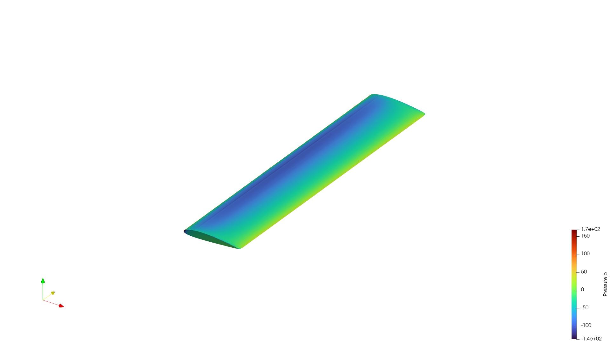
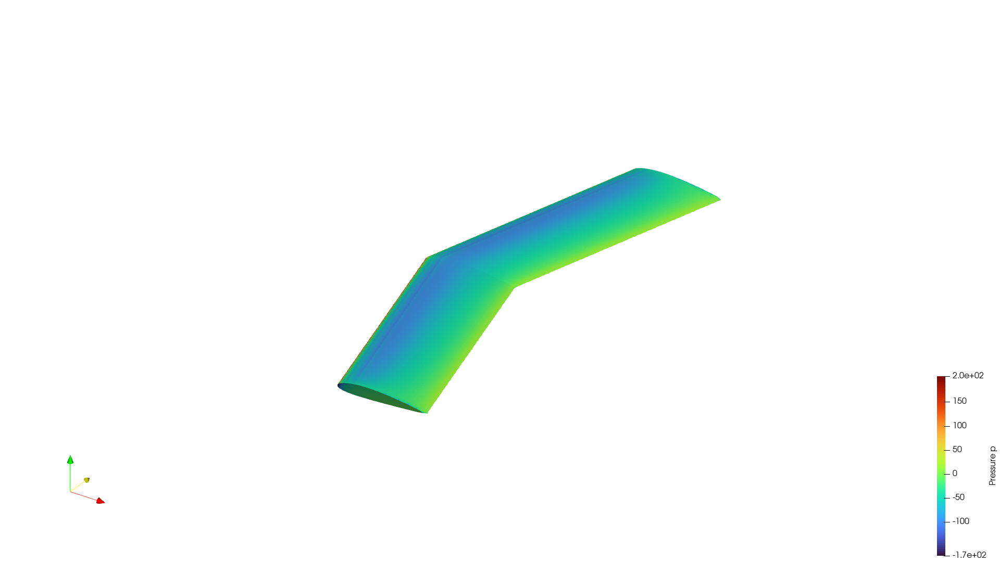
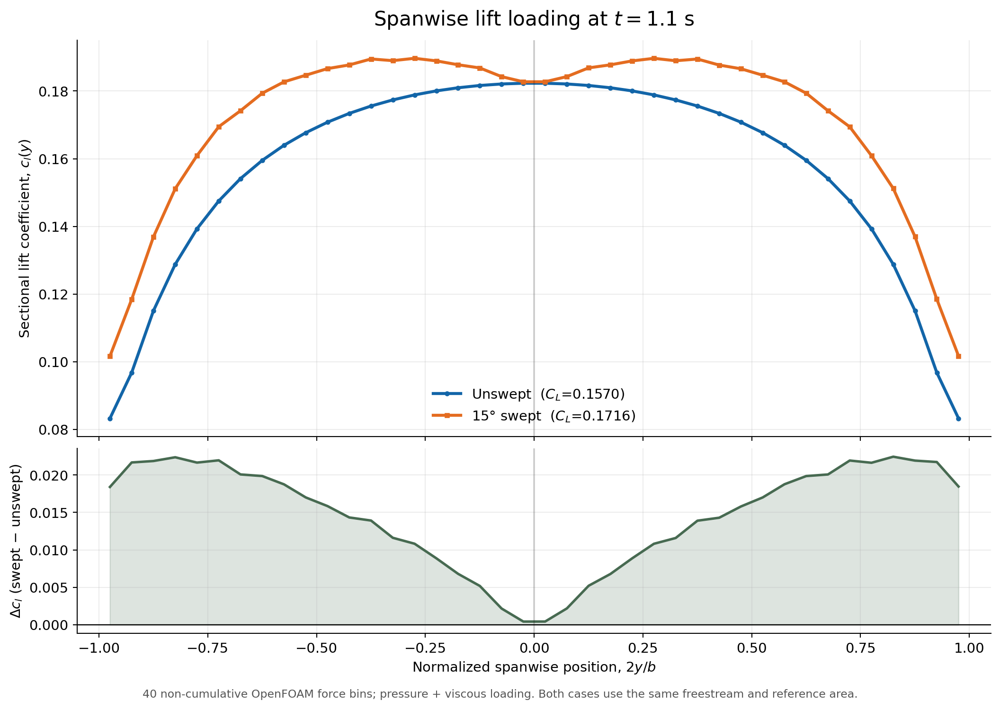

<p align="center">
  
</p>

# NACA 2412 wing sweep study

**OpenFOAM learning project · CFD setup · aerodynamic post-processing · ParaView visualization**

This hands-on study compares two finite NACA 2412 wings with the same nominal 1 m chord, 5 m span, and 5 m² reference area: a straight wing and a wing with 15° quarter-chord sweep. It demonstrates parametric STL generation, OpenFOAM case setup, meshing, transient RANS, aerodynamic analysis, and ParaView visualization. A longer-term aim is comparison with the companion [vortex panel method project](https://github.com/Prithvi1352/Vortex_panel_method).


<p align="center">
  <a href="#case-definition">Case definition</a> ·
  <a href="#selected-results">Results</a> ·
  <a href="results/README.md">Results gallery</a> ·
  <a href="#run-the-baseline-case">Run the case</a>
</p>

## Case definition

| Item | Configuration |
| --- | --- |
| Airfoil / planform | NACA 2412; constant-chord finite wings, unswept and swept |
| Geometry | chord 1 m · span 5 m · reference area 5 m² · aspect ratio 5 |
| Sweep cases | 0° and 15° quarter-chord sweep |
| Freestream | `U∞ = 20 m/s` in the +x direction; `ν = 1.5 × 10⁻⁵ m²/s`; `ρ = 1.225 kg/m³` |
| Chord Reynolds number | `Re_c ≈ 1.33 × 10⁶` |
| Flow model | transient, incompressible RANS; k–ω SST ([Menter, 1994](https://doi.org/10.2514/3.12149)); `pimpleFoam` |
| Current time settings | `Δt = 1 × 10⁻⁴ s`; target end time 2.5 s; nominal field-write interval 0.1 s |
| Forces / parallel setup | `forceCoeffs` on `wing`; `Aref = 5 m²`; lift +z, drag +x; four-subdomain decomposition |
| Mesh workflow | `blockMesh` → feature extraction → `snappyHexMesh` → `potentialFoam` → `pimpleFoam` |

The mesh uses STL surface snapping and local refinement around the wing and wake. The checked meshes contain approximately **3.69 M cells** (0°) and **3.89 M cells** (15°); the current `snappyHexMeshDict` has boundary-layer addition disabled.

## Selected results

| 0° unswept | 15° swept |
| --- | --- |
|  |  |

The table compares recorded CFD coefficients at the **common saved time t = 1.1 s**, with identical freestream and reference-area normalization. These are instantaneous samples, not time averages. Surface colours show kinematic pressure `p/ρ` (m²/s²) on independent colour scales; they are not a quantitative pressure comparison.

| Case | $C_L$ | $C_D$ (total) | $L/D$ |
| --- | ---: | ---: | ---: |
| 0° unswept | 0.15697 | 0.022899 | 6.85 |
| 15° swept | 0.17164 | 0.024004 | 7.15 |
| Difference relative to unswept | +9.35% | +4.83% | +4.31% |



**CFD observation:** the swept case has higher recorded lift and total drag, with higher sectional loading over much of the span at this instant. **Interpretation:** the cause and numerical significance of the difference remain unverified. Finite-wing theory connects spanwise loading to induced drag, but these total-force records do not isolate induced drag or establish a sweep mechanism. See the [results guide](results/README.md) for data provenance, theory references, and limitations.

The main verification priorities are near-wall resolution (wall functions, no added prism layers), the concave-cell checks reported by `checkMesh`, and mesh/time-step sensitivity. The project demonstrates the simulation and analysis workflow; validation and numerical-uncertainty estimates remain future work.

## Project layout

```text
.
├── 0/ · constant/ · system/    # 0° wing case: fields, properties, and dictionaries
├── sweep_15/                   # 15° wing case with matching case structure
├── wing_geometries/            # Parametric baseline-wing generator and STL
├── results/                    # Curated GitHub figures, GIFs, and result notes
└── Allrun / Allclean           # Baseline mesh-and-solve workflow / cleanup
```

Raw time directories, decomposed processor cases, and post-processing working files are deliberately not part of the curated `results/` gallery.

## Run the baseline case

An OpenFOAM installation with the standard meshing and solver utilities is required.

```bash
./Allrun     # blockMesh, checks, feature extraction, snappyHexMesh, potentialFoam, pimpleFoam
./Allclean   # remove generated baseline case data
```

The 15° setup is in [`sweep_15/`](sweep_15/); its geometry is generated by [`generate_naca2412_swept_wing.py`](sweep_15/generate_naca2412_swept_wing.py). See [the results guide](results/README.md) for visualisation provenance and interpretation notes.
