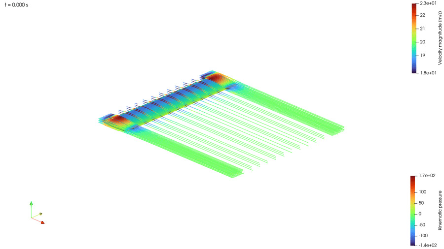
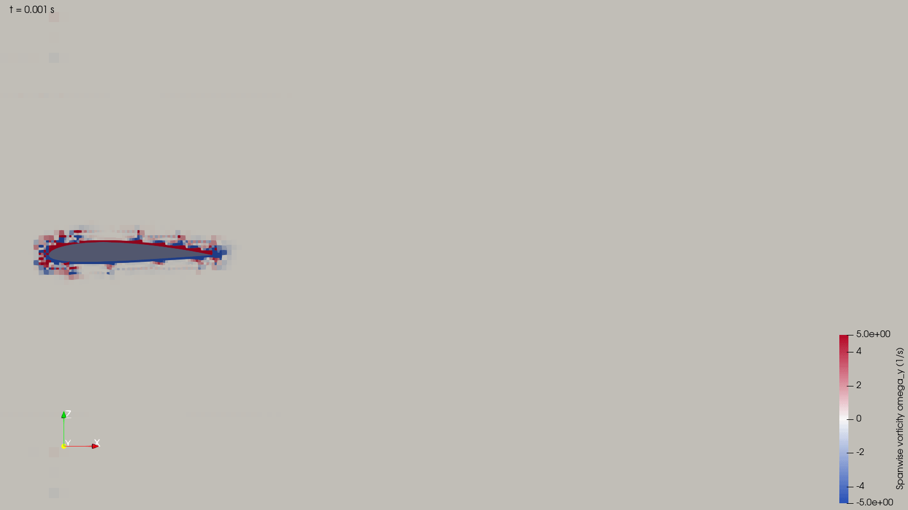
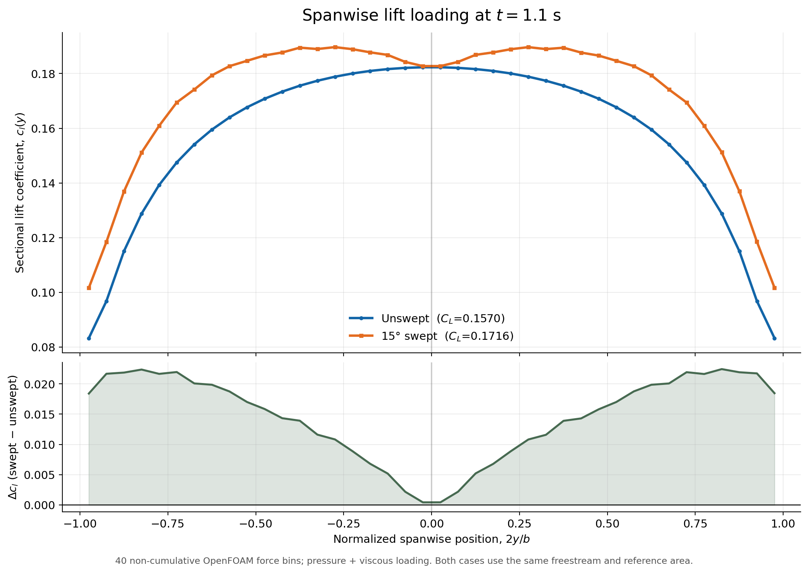
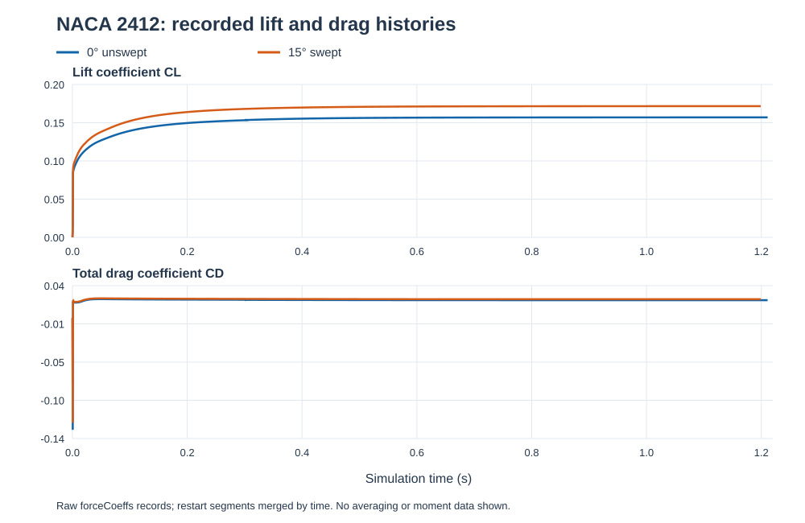

# Results gallery

Curated visualizations and lift/drag plots from the two OpenFOAM cases. Raster images and GIFs are copied from existing exports; the SVG histories are regenerated directly from `forceCoeffs.dat`. Original CFD files are preserved.

## 0° unswept wing

| Asset | What it shows |
| --- | --- |
| [Surface pressure](unswept/pressure_surface.png) | Export of OpenFOAM `p`, the kinematic pressure (m²/s²); export script selects t = 1.211 s. |
| [Lift and drag history](unswept/lift_drag_history.svg) | Recorded coefficients, including the initialization transient; no time averaging. |
| [Flow-field animation](unswept/flow_field.gif) | Instantaneous streamlines coloured by speed, with surface kinematic pressure. Streamlines are not particle trajectories. |

The available force history extends to **t = 1.211 s**.

## 15° swept wing

| Asset | What it shows |
| --- | --- |
| [Surface pressure](swept_15/pressure_surface.png) | Kinematic-pressure export; export script selects t = 1.1997 s. Colour limits differ from the unswept export. |
| [Lift and drag history](swept_15/lift_drag_history.svg) | Recorded swept-case coefficients, including the initialization transient. |
| [Spanwise-vorticity animation](swept_15/spanwise_vorticity.gif) | Early-transient midspan slice of ωy (s⁻¹). The rendering script clips the colour scale; this does not measure vortex circulation or identify a discrete starting vortex. |

The available force history extends to **t = 1.199 s**; the final saved field time differs slightly.

## Comparison

**Computed observation.** At **t = 1.1 s**, the integrated records give `(CL, CD) = (0.156970744, 0.0228994203)` for 0° and `(0.171640618, 0.0240044803)` for 15°. Relative to 0°, the differences are **+9.35% in CL**, **+4.83% in total CD**, and **+4.31% in CL/CD** (6.85 → 7.15). They are differences between sampled CFD solutions; their uncertainty has not been quantified.

The loading figure uses **40 non-cumulative spanwise force bins**, including pressure and viscous forces. Sectional `cl = CL_bin Aref/(c Δy)`; bin positions are represented by their centres. Independently summing the bin lift coefficients gives **0.15697074407** and **0.17164061765**, agreeing with the integrated outputs within their printed precision. The plotted loading is higher for the swept case over much of the span; no mechanism is inferred from the curve alone.

**Established theory.** Finite-wing lifting-line theory relates spanwise circulation and the trailing vortex system to induced drag ([Prandtl, NACA TR-116](https://ntrs.nasa.gov/citations/19930091180), part II). This provides context for examining loading distributions. Total surface-force drag here has not been separated into induced and profile contributions, so the comparison does not establish an induced-drag reduction or a general benefit of sweep.

**Hypotheses requiring verification.** Explaining the lift difference through sweep-induced changes in loading, local flow, or numerical resolution requires additional analysis. Surface colours and the midspan vorticity slice alone do not demonstrate spanwise boundary-layer flow, separation onset, or vortex strength.

## Interpretation limits

- **Mesh quality:** `checkMesh` reports 3,693,084 cells (0°) and 3,894,055 (15°), with 60,338 and 62,377 concave cells respectively; each log ends with one failed check. Assess their locations and force sensitivity rather than inferring a coefficient error from the counts alone.
- **Near-wall treatment:** both dictionaries disable layer addition and use `nutkWallFunction`. At t = 1.1 s, reported wing y+ ranges are approximately 38–501 (0°) and 27–533 (15°), with patch averages 254 and 258. These are wall-function calculations, not wall-resolved boundary-layer results; wall treatment and near-wall refinement need sensitivity assessment, particularly for drag. SST is an eddy-viscosity RANS closure ([Menter, 1994](https://doi.org/10.2514/3.12149)), not a resolution of all turbulent motion.
- **Verification and validation:** late force histories flatten, but this does not establish mesh independence, time-step independence, or experimental agreement. Systematic refinement and discretization-uncertainty estimation are appropriate next steps ([Celik et al., 2008](https://doi.org/10.1115/1.2960953)), alongside domain/boundary-condition sensitivity and a suitable validation case. Current dictionaries target 2.5 s; the presented records cover only the available portion of each run.

## Numerical provenance

Paths below identify local evidence; raw outputs are excluded from this gallery. Restart force segments were merged in increasing start-time order, keeping the later segment at duplicate times.

| Statement | Local source |
| --- | --- |
| Common-time coefficients | `postProcessing/forceCoeffs/1.1/forceCoeffs.dat`; `sweep_15/postProcessing/forceCoeffs/0.8/forceCoeffs.dat`, rows at 1.1 s |
| Loading and integrated cross-check | Both cases: `postProcessing/spanwiseLift/1.1/forceCoeffs_bins.dat` and adjacent `forceCoeffs.dat`; `system/spanwiseLiftDict` |
| Mesh counts and checks | `log.checkMesh.snappy` in each case |
| Wall treatment and y+ | Both `0/nut` and `system/snappyHexMeshDict`; baseline `postProcessing/yPlus/1.1/yPlus.dat` and swept `postProcessing/yPlus/0.8/yPlus.dat` |
| Input parameters | Both `0/U`, `constant/transportProperties`, `constant/turbulenceProperties`, and `system/controlDict`; geometry-generator settings |

`Re_c = U∞c/ν ≈ 1.33 × 10⁶`; `AR = b²/S = 5`. Geometry dimensions are nominal generator inputs; force normalization is independently recorded in the output headers. Percentages use unrounded coefficients, not the rounded landing-page table.

## References

1. Prandtl, L. *Applications of Modern Hydrodynamics to Aeronautics*, NACA TR-116, 1923 edition, part II. [NASA archive](https://ntrs.nasa.gov/citations/19930091180).
2. Menter, F. R. “Two-Equation Eddy-Viscosity Turbulence Models for Engineering Applications.” *AIAA Journal*, 32(8), 1598–1605, 1994. [doi:10.2514/3.12149](https://doi.org/10.2514/3.12149).
3. Celik, I. B., et al. “Procedure for Estimation and Reporting of Uncertainty Due to Discretization in CFD Applications.” *Journal of Fluids Engineering*, 130(7), 078001, 2008. [doi:10.1115/1.2960953](https://doi.org/10.1115/1.2960953).
